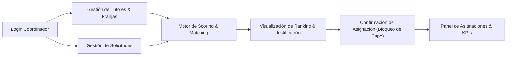

# Entregable 1: Plan de Pruebas de Calidad (Test Plan)

**Proyecto:** Auditoría Integral de Calidad y Preparación para Producción  
**Aplicación Auditada:** TutorAssigner — Sistema de Matching de Tutorías entre Pares  
**Equipo Consultor QA:** QA Advisory & Testing Partners (Equipo de 2 Ingenieros de QA)  
**Versión del Plan:** 1.0  
**Fecha:** Octubre 2026  
**Estándar de Referencia:** ISO/IEC/IEEE 29119-3 (Test Documentation) / ISTQB Certified Tester Standard  

---

## 1. Objetivo de la Auditoría

### 1.1 Propósito Principal
Establecer y ejecutar una auditoría técnica e independiente sobre la plataforma web **TutorAssigner**, con el fin de evaluar su nivel de calidad, estabilidad funcional, robustez ante entradas anómalas, precisión de su motor algorítmico de matching y grado de preparación técnica (*production-readiness*) previo a su despliegue en un entorno institucional de producción.

### 1.2 Objetivos Específicos
1. **Verificación Funcional:** Validar que los flujos críticos de negocio (gestión de tutores, disponibilidad horaria, registro de solicitudes, cálculo de compatibilidad algorítmica y confirmación de asignaciones) operen conforme a los requisitos establecidos.
2. **Evaluación de Robustez y Manejo de Excepciones:** Determinar la resiliencia del software frente a datos inválidos, valores fuera de rango, solapamientos temporales y peticiones no autorizadas mediante técnicas de Caja Negra (Partición de Equivalencia, Valores Límite, Tablas de Decisión y Transición de Estados).
3. **Detección y Clasificación de Defectos:** Identificar, documentar y reportar un mínimo de 10 defectos reales, categorizándolos según su impacto (*Severidad*) y urgencia de solución (*Prioridad*).
4. **Automatización de Pruebas de Regresión:** Implementar una suite automatizada de pruebas End-to-End (E2E) con **Playwright** que cubra al menos 5 flujos críticos, garantizando verificabilidad continua.
5. **Medición de Cobertura:** Cuantificar el grado de cobertura alcanzado (cobertura de requisitos, casos de prueba y código fuente), superando el umbral mínimo del 50%.
6. **Dictamen Técnico Imparcial:** Emitir un informe gerencial y técnico sustentado con la decisión concluyente (**Sí** o **No**) sobre si la aplicación está lista para salir a producción.

---

## 2. Alcance de la Auditoría

El alcance delimita con precisión las fronteras operativas y funcionales de la auditoría de calidad.

### 2.1 Funcionalidades Incluidas (In-Scope)

| Módulo / Componente | Descripción y Flujos Auditados |
| :--- | :--- |
| **M01: Autenticación y Autorización (`auth`)** | Control de acceso con JWT y cookies seguras, validación de credenciales del rol `COORDINADOR`, protección de rutas privadas, persistencia de sesión y caducidad. |
| **M02: Gestión de Tutores y Materias (`tutores`)** | Alta y actualización de tutores, asignación de catálogo de materias con nivel de dominio (1–5), definición de franjas horarias semanales continuas, nivel de prioridad (1–5), modalidad y capacidad máxima de tutorías. |
| **M03: Gestión de Estudiantes y Solicitudes (`solicitudes`)** | Registro de estudiantes, emisión de solicitudes con materia, duración requerida (30–240 min), franjas de disponibilidad semanal, preferencias (modalidad, tutor preferido) y cancelación. |
| **M04: Motor de Matching Puro (`packages/matching`)** | Filtros duros de elegibilidad (materia activa, cupo disponible y solape horario continuo ≥ duración), ponderación de criterios normalizados (0–100), reglas de desempate y generación determinista de justificaciones textuales. |
| **M05: Recomendaciones y Asignaciones (`recomendaciones`)** | Generación de snapshot de recomendación, visualización de ranking de candidatos con desglose métrico, descarte con causales, confirmación de asignación con bloqueo concurrente y reasignación justificada. |
| **M06: Configuración del Sistema (`matching_config`)** | Ajuste dinámico y versionado de pesos para los criterios de afinidad (suma estricta = 100%), parámetros de ranking (`topN`, bloques ideales). |

### 2.2 Funcionalidades y Elementos Excluidos (Out-of-Scope)

| Elemento Excluido | Justificación Técnica |
| :--- | :--- |
| **Pasarelas de Pago** | El modelo del sistema es de tutorías académicas institucionales entre pares, sin cobro monetario. |
| **Servidores de Notificación SMTP/SMS** | No forma parte del MVP contratado; el sistema gestiona la comunicación interna dentro de la aplicación web. |
| **Integración con Directorio Activo Institucional / SSO (OAuth2 / SAML)** | Se audita el esquema de autenticación propio implementado; los conectores federados están planificados para fases posteriores. |
| **Compatibilidad con Aplicaciones Móviles Nativas** | La auditoría se enfoca exclusivamente en la aplicación web responsive (Desktop y Tablet). |
| **Pruebas de Estrés y Carga Masiva (> 10,000 req/s)** | El dimensionamiento actual del sistema está acotado al flujo de un campus universitario con volumen controlado. |

---

## 3. Funcionalidades por Evaluar: Módulos, Procesos y Flujos

### 3.1 Procesos y Flujos Seleccionados para Pruebas

#### Flujo 1: Ciclo de Vida del Tutor (Alta, Disponibilidad y Estado)
- Validación de formato de correo institucional único.
- Configuración de franjas horarias semanales (días 1 a 7, formato HH:mm, validación `fin > inicio`).
- Detección y rechazo de solapamientos horarios en la misma disponibilidad del tutor.
- Modificación de estado (Activo / Inactivo) y verificación del impacto inmediato en el motor de asignaciones.

#### Flujo 2: Creación y Parametrización de Solicitudes Estudiantiles
- Selección obligatoria de estudiante y materia activa.
- Validación de límites en la duración de la sesión (valores entre 30 y 240 minutos).
- Registro de franjas horarias solicitadas y preferencias pedagógicas (Presencial, Virtual o Sin Preferencia).
- Transición inicial de estado a `ABIERTA`.

#### Flujo 3: Evaluación Algorítmica de Matching y Recomendación
- Verificación del filtrado previo de tutores elegibles: descarte automático de tutores sin cupo (`SIN_CUPO`) o sin intersección horaria suficiente (`SIN_HORARIO_COMPATIBLE`).
- Cálculo ponderado de score sobre 100 puntos con los 5 criterios: Dominio (30%), Horario (25%), Prioridad (20%), Preferencias (15%), Carga (10%).
- Comprobación de determinismo: ante idénticos datos de entrada y versión de configuración, el motor debe producir el mismo ranking y justificación.
- Aplicación de reglas de desempate en cascada.

#### Flujo 4: Confirmación y Cierre de Asignación
- Confirmación directa del tutor recomendado (Top 1) con confirmación explícita del usuario.
- Selección de una alternativa con requerimiento obligatorio de motivo de cambio.
- Cambio atómico de estado de la solicitud (`ABIERTA` $\to$ `ASIGNADA`).
- Incremento de la carga activa del tutor y validación contra su `capacidad_maxima`.

#### Flujo 5: Gestión de Configuración y Pesos
- Validación de integridad matemática: la suma de las ponderaciones debe ser igual al 100% (tolerancia flotante $\pm 0.001$).
- Persistencia de nueva versión inmutable de configuración (`version = N + 1`) manteniendo vigencia única.
- Garantía de que las recomendaciones históricas no alteren retrospectivamente su score original.

---

## 4. Matriz de Evaluación y Gestión de Riesgos

Se evalúan los riesgos potenciales que amenazan la calidad del producto y el éxito de la auditoría:

| ID | Categoría | Descripción del Riesgo | Impacto | Probabilidad | Estrategia de Mitigación / Contingencia |
| :---: | :---: | :--- | :---: | :---: | :--- |
| **R-01** | **Concurrencia** | Dos coordinadores asignan simultáneamente al mismo tutor cuando solo queda un cupo disponible. | **Alto** | Media | Diseñar pruebas de concurrencia y validar que el API utilice transacciones y bloqueos consultivos a nivel de BD (`pg_advisory_xact_lock`). |
| **R-02** | **Algorítmico** | Errores de redondeo de punto flotante en la suma ponderada del score de matching o en la suma de pesos del 100%. | **Medio** | Alta | Pruebas de valores límite con fast-check y validación estricta de precisión decimal (`Math.round`) en el motor. |
| **R-03** | **Datos** | Registro de franjas horarias inconsistentes (ej. fin menor a inicio, solapes dentro del mismo día). | **Alto** | Media | Pruebas negativas intensivas en la capa de contratos Zod y en las utilidades de franjas horarias. |
| **R-04** | **Regresión** | Modificaciones en endpoints del API que rompan el contrato tipado consumido por el frontend en React. | **Alto** | Media | Validación automatizada con esquemas Zod compartidos en `@tutorias/contracts` y suite de Playwright E2E. |
| **R-05** | **Entorno** | Inestabilidad en la base de datos PostgreSQL efímera durante la ejecución masiva de pruebas de integración. | **Medio** | Baja | Contenerización total del stack de pruebas mediante Docker Compose con perfiles aislados (`test` y `e2e`). |

---

## 5. Estrategia y Enfoque de Pruebas

La auditoría implementará una estrategia de pirámide de pruebas adaptada a la auditoría QA:
- **Nivel Unitario / Componentes:** Pruebas de caja blanca sobre el motor puro de scoring y utilidades de tiempo con Vitest.
- **Nivel de Integración y Contratos:** Pruebas de API REST con Supertest validando esquemas Zod, códigos de estado HTTP y transaccionalidad.
- **Nivel End-to-End (E2E):** Pruebas de caja negra con Playwright simulando las interacciones reales del usuario coordinador en el navegador Chromium.

### Criterios de Aceptación de la Auditoría
- Diseño y ejecución del 100% de los 30 casos de prueba planificados.
- Identificación y reporte exhaustivo de al menos 10 defectos con evidencias.
- Ejecución limpia y reproducible de la suite automatizada de Playwright (mínimo 5 casos).
- Cobertura de pruebas reportada y sustentada superior al 50%.
- Elaboración del concepto técnico final debidamente justificado.

