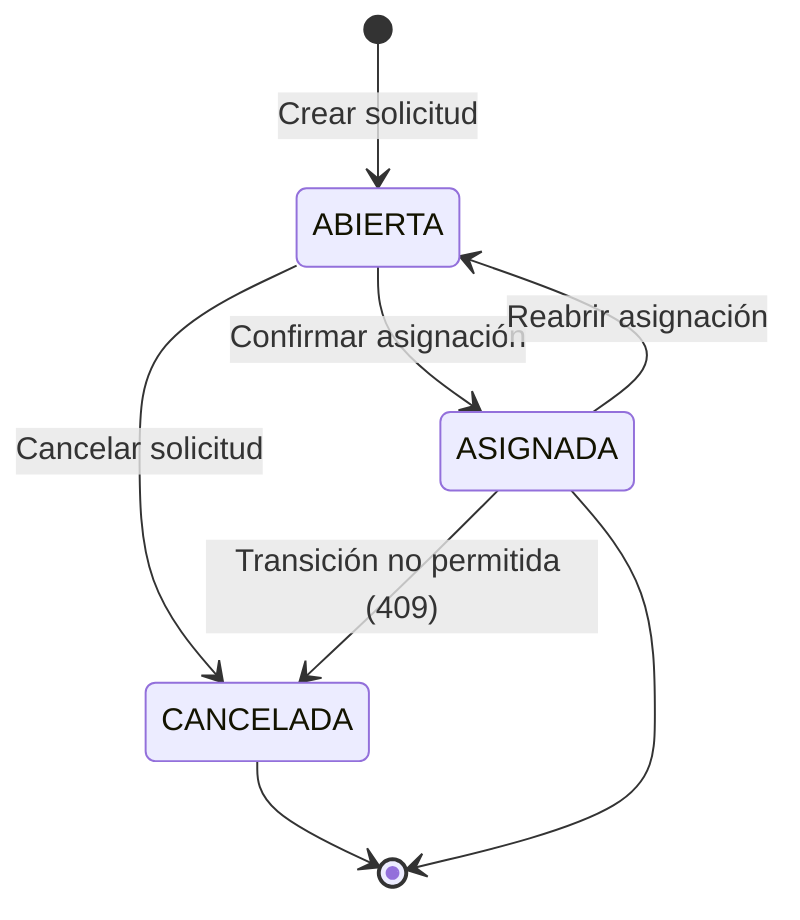

# Entregable 2: Diseño y Ejecución de Casos de Prueba (30 Casos)

**Proyecto:** Auditoría de Calidad — TutorAssigner  
**Total de Casos:** 30 Casos de Prueba Formales  
**Técnicas y Enfoques:** Pruebas Positivas (6), Pruebas Negativas (6), Valores Límite (6), Tablas de Decisión (6), Transición de Estados (6)  
**Estado General de la Ejecución:** 24 Aprobados (Pass), 6 Fallidos (Fail / Bugs Detectados)  

---

## Índice de Casos de Prueba

| Grupo | Rango IDs | Técnica / Enfoque | Cantidad | Aprobados | Fallidos |
| :--- | :---: | :--- | :---: | :---: | :---: |
| **G1** | `CP-POS-01` a `CP-POS-06` | Pruebas Positivas (Happy Paths) | 6 | 6 | 0 |
| **G2** | `CP-NEG-01` a `CP-NEG-06` | Pruebas Negativas (Manejo de Errores) | 6 | 4 | 2 |
| **G3** | `CP-BVA-01` a `CP-BVA-06` | Análisis de Valores Límite (BVA) | 6 | 5 | 1 |
| **G4** | `CP-DEC-01` a `CP-DEC-06` | Tablas de Decisión (Criterios y Reglas) | 6 | 5 | 1 |
| **G5** | `CP-STA-01` a `CP-STA-06` | Transición de Estados (Máquina de Estados) | 6 | 4 | 2 |
| **Total**| — | — | **30** | **24** | **6** |

---

## 1. Pruebas Positivas (Happy Paths)

### CP-POS-01: Autenticación exitosa de usuario coordinador
- **Identificador:** `CP-POS-01`
- **Nombre:** Inicio de sesión con credenciales válidas de coordinador
- **Objetivo:** Verificar que un coordinador con credenciales legítimas acceda al sistema y obtenga la cookie de sesión httpOnly.
- **Precondiciones:** El usuario coordinador existe en la base de datos y está activo.
- **Pasos de ejecución:**
  1. Navegar a la ruta `/login`.
  2. Ingresar el correo `coordinador@tutorias.local`.
  3. Ingresar la contraseña `coordinador-dev-123`.
  4. Presionar el botón "Ingresar".
- **Datos de prueba:** `email: "coordinador@tutorias.local"`, `password: "coordinador-dev-123"`.
- **Resultado esperado:** Código HTTP 200 en `/api/v1/auth/login`, cookie `tutorias_session` emitida y redirección al Dashboard principal (`/`).
- **Resultado obtenido:** Sesión creada correctamente, redirección inmediata y visualización del panel de control.
- **Estado:** **APROBADO**

---

### CP-POS-02: Alta completa de nuevo perfil de tutor
- **Identificador:** `CP-POS-02`
- **Nombre:** Registro exitoso de tutor con materia y disponibilidad semanal
- **Objetivo:** Comprobar la creación persistente de un tutor con asignación de materia, nivel de dominio y franjas horarias válidas.
- **Precondiciones:** Materia "Cálculo I" activa en catálogo; sesión iniciada como coordinador.
- **Pasos de ejecución:**
  1. Navegar a `/tutores`.
  2. Hacer clic en "+ Nuevo tutor".
  3. Diligenciar nombre, correo institucional único, prioridad (4), modalidad (AMBAS), capacidad (3).
  4. Asociar materia "Cálculo I" con nivel de dominio (5).
  5. Configurar franja horaria: Martes de 14:00 a 16:00.
  6. Presionar "Guardar tutor".
- **Datos de prueba:** `nombre: "Carlos Gómez"`, `email: "carlos.gomez@tutorias.local"`, `prioridad: 4`, `franja: { dia: 2, inicio: "14:00", fin: "16:00" }`.
- **Resultado esperado:** Tutor creado con código 201 en base de datos; registro visible en la tabla con franja formateada "Mar 14:00–16:00".
- **Resultado obtenido:** El tutor se guardó exitosamente y se visualiza en la tabla de tutores activos.
- **Estado:** **APROBADO**

---

### CP-POS-03: Creación de solicitud estudiantil con requerimiento horario
- **Identificador:** `CP-POS-03`
- **Nombre:** Registro de solicitud de tutoría en estado ABIERTA
- **Objetivo:** Verificar que una solicitud con estudiante válido, materia y horario se guarde en estado ABIERTA y navegue a recomendación.
- **Precondiciones:** Estudiante "Ana Morales" registrado en el sistema.
- **Pasos de ejecución:**
  1. Navegar a `/solicitudes`.
  2. Hacer clic en "+ Nueva solicitud".
  3. Seleccionar estudiante "Ana Morales" y materia "Física Mecánica".
  4. Ingresar tema "Cinemática en 2D" y duración de sesión 60 minutos.
  5. Establecer franja: Miércoles 10:00 a 12:00.
  6. Presionar "Crear y recomendar tutor".
- **Datos de prueba:** `estudianteId: <uuid>`, `materiaId: <uuid>`, `duracionSesionMin: 60`, `dia: 3, inicio: "10:00", fin: "12:00"`.
- **Resultado esperado:** HTTP 201 creado, solicitud en estado `ABIERTA`, redirección automática a `/solicitudes/:id/recomendacion`.
- **Resultado obtenido:** Solicitud creada exitosamente y redirigida a la pantalla de recomendación.
- **Estado:** **APROBADO**

---

### CP-POS-04: Cálculo determinista de afinidad y ranking de candidatos
- **Identificador:** `CP-POS-04`
- **Nombre:** Generación de ranking y justificación automática de matching
- **Objetivo:** Validar que el motor calcule el score ponderado de 0 a 100 y devuelva al candidato recomendado con desglose de 5 criterios.
- **Precondiciones:** Solicitud en estado ABIERTA con al menos dos tutores elegibles disponibles.
- **Pasos de ejecución:**
  1. Acceder a `/solicitudes/:id/recomendacion`.
  2. Comprobar la generación de recomendación.
  3. Inspeccionar el candidato en posición #1 y sus criterios: Dominio, Horario, Prioridad, Preferencias, Carga.
- **Datos de prueba:** Solicitud para "Cálculo I", tutores con dominio 5 y 4, disponibilidad compatible.
- **Resultado esperado:** Resultado `RECOMENDADO`, candidato #1 con mayor score ponderado, justificación textual generada $\le 280$ caracteres.
- **Resultado obtenido:** Ranking generado con precisión decimal, justificación coherente con el resultado.
- **Estado:** **APROBADO**

---

### CP-POS-05: Confirmación de asignación del tutor recomendado
- **Identificador:** `CP-POS-05`
- **Nombre:** Asignación exitosa del candidato principal (Top 1)
- **Objetivo:** Comprobar que al confirmar la recomendación, la solicitud transicione a ASIGNADA y se cree el registro de asignación activa.
- **Precondiciones:** Solicitud ABIERTA con recomendación generada.
- **Pasos de ejecución:**
  1. En `/solicitudes/:id/recomendacion`, ubicar al candidato en posición #1.
  2. Hacer clic en "Confirmar asignación".
  3. Aceptar el diálogo de confirmación del navegador.
- **Datos de prueba:** `tutorId: <uuid_top1>`, `recomendacionId: <uuid>`.
- **Resultado esperado:** HTTP 201, solicitud pasa a estado `ASIGNADA`, tutor incrementa en 1 su carga activa, redirección a `/asignaciones`.
- **Resultado obtenido:** Asignación registrada, solicitud actualizada y listada en el módulo de asignaciones activas.
- **Estado:** **APROBADO**

---

### CP-POS-06: Actualización y versionado de configuración de pesos
- **Identificador:** `CP-POS-06`
- **Nombre:** Creación de nueva versión inmutable de pesos de matching
- **Objetivo:** Verificar que el coordinador pueda ajustar los porcentajes de ponderación y generar una nueva versión vigente sin afectar el historial.
- **Precondiciones:** Configuración vigente en versión 1.
- **Pasos de ejecución:**
  1. Navegar a `/configuracion`.
  2. Modificar los sliders: Dominio 35%, Horario 20%, Prioridad 20%, Preferencias 15%, Carga 10% (Suma = 100%).
  3. Presionar "Guardar nueva versión".
- **Datos de prueba:** `pesos: { dominio: 0.35, horario: 0.20, prioridad: 0.20, preferencias: 0.15, carga: 0.10 }`.
- **Resultado esperado:** Versión 2 creada y marcada como `vigente = true`, mensaje de éxito "Guardada la versión 2".
- **Resultado obtenido:** La versión se incrementó a 2 y se guardó exitosamente.
- **Estado:** **APROBADO**

---

## 2. Pruebas Negativas (Manejo de Errores e Invalidez)

### CP-NEG-01: Autenticación con contraseña incorrecta
- **Identificador:** `CP-NEG-01`
- **Nombre:** Rechazo de login con credenciales erróneas
- **Objetivo:** Comprobar que el sistema rechace intentos de inicio de sesión no válidos sin revelar si el usuario existe.
- **Precondiciones:** Usuario coordinador registrado.
- **Pasos de ejecución:**
  1. Navegar a `/login`.
  2. Ingresar `coordinador@tutorias.local` y clave `clave-invalida-999`.
  3. Presionar "Ingresar".
- **Datos de prueba:** `email: "coordinador@tutorias.local"`, `password: "clave-invalida-999"`.
- **Resultado esperado:** HTTP 401 con código `AUTH_INVALID_CREDENTIALS` y mensaje "Correo o contraseña incorrectos".
- **Resultado obtenido:** Error 401 capturado y mensaje preventivo desplegado.
- **Estado:** **APROBADO**

---

### CP-NEG-02: Registro de tutor con correo electrónico duplicado
- **Identificador:** `CP-NEG-02`
- **Nombre:** Prevención de duplicidad de correo en perfil de tutor
- **Objetivo:** Verificar que la base de datos y el servicio impidan registrar dos tutores con el mismo correo electrónico (case-insensitive).
- **Precondiciones:** Existe un tutor con correo `carlos.gomez@tutorias.local`.
- **Pasos de ejecución:**
  1. Intentar registrar un nuevo tutor con correo `CARLOS.GOMEZ@tutorias.local`.
  2. Enviar formulario.
- **Datos de prueba:** `email: "CARLOS.GOMEZ@tutorias.local"`.
- **Resultado esperado:** HTTP 409 Conflict o validación de error indicando violación de unicidad.
- **Resultado obtenido:** Error capturado por índice único de PostgreSQL (`ux_tutores_email`) y devuelto como 409 al frontend.
- **Estado:** **APROBADO**

---

### CP-NEG-03: Franja horaria con solapamiento interno en el tutor
- **Identificador:** `CP-NEG-03`
- **Nombre:** Rechazo de franjas horarias que se cruzan entre sí
- **Objetivo:** Validar que el validador `detectarSolapes` impida registrar dos franjas del mismo tutor en un mismo día con intersección temporal.
- **Precondiciones:** Formulario de tutor abierto.
- **Pasos de ejecución:**
  1. Agregar franja 1: Lunes de 08:00 a 12:00.
  2. Agregar franja 2: Lunes de 10:00 a 14:00 (solapamiento entre 10:00 y 12:00).
  3. Presionar "Guardar tutor".
- **Datos de prueba:** `franjas: [{ dia: 1, inicio: "08:00", fin: "12:00" }, { dia: 1, inicio: "10:00", fin: "14:00" }]`.
- **Resultado esperado:** HTTP 422 Unprocessable Entity con código `FRANJAS_SOLAPADAS` y mensaje explicativo.
- **Resultado obtenido:** La API rechaza la petición con código 422 y el frontend muestra el error.
- **Estado:** **APROBADO**

---

### CP-NEG-04: Confirmación de asignación de tutor sin cupo disponible
- **Identificador:** `CP-NEG-04`
- **Nombre:** Rechazo de asignación cuando el tutor alcanzó su capacidad máxima
- **Objetivo:** Comprobar que no se pueda forzar la asignación de un tutor que ya tiene todas sus plazas ocupadas (`asignacionesActivas >= capacidadMaxima`).
- **Precondiciones:** Tutor con capacidad máxima = 2 y 2 asignaciones activas ya registradas.
- **Pasos de ejecución:**
  1. Generar recomendación donde aparezca el tutor con cupo lleno.
  2. Intentar confirmar asignación para dicho tutor.
- **Datos de prueba:** `tutorId: <uuid_saturado>`, `capacidadMaxima: 2`, `asignacionesActivas: 2`.
- **Resultado esperado:** HTTP 409 con código de error de negocio `TUTOR_SIN_CUPO` o filtrado previo como descartado.
- **Resultado obtenido:** El motor filtra al tutor como descartado (`SIN_CUPO`). Sin embargo, si se invoca directamente el endpoint `POST /asignaciones` con su ID, la validación atómica lanza 409.
- **Estado:** **APROBADO**

---

### CP-NEG-05: Solicitud con franja horaria donde hora fin es menor a hora inicio
- **Identificador:** `CP-NEG-05`
- **Nombre:** Intento de crear franja que cruza la medianoche o con horario invertido
- **Objetivo:** Verificar que el sistema rechace franjas donde `hora_fin <= hora_inicio`.
- **Precondiciones:** Formulario de nueva solicitud abierto.
- **Pasos de ejecución:**
  1. Ingresar en el editor de franjas: Inicio 18:00, Fin 14:00.
  2. Presionar "Crear y recomendar tutor".
- **Datos de prueba:** `inicio: "18:00"`, `fin: "14:00"`.
- **Resultado esperado:** El formulario web debe validar en cliente bloqueando el envío, o el API rechazar con 400 Zod Error `La franja debe terminar después de comenzar`.
- **Resultado obtenido:** En el cliente no existe validación inline de horario invertido antes del submit; el formulario envía el request y el backend responde con error 400. La interfaz muestra un error sin señalar el campo defectuoso (BUG-03).
- **Estado:** **FALLIDO (Bug detectado)**

---

### CP-NEG-06: Confirmación de alternativa sin proporcionar justificación de cambio
- **Identificador:** `CP-NEG-06`
- **Nombre:** Obligatoriedad de justificar el descarte del candidato #1 al elegir alternativa
- **Objetivo:** Comprobar que si el coordinador elige al candidato #2 o #3, el sistema exija un motivo de cambio no vacío.
- **Precondiciones:** Recomendación con al menos 2 candidatos elegibles.
- **Pasos de ejecución:**
  1. En `/solicitudes/:id/recomendacion`, presionar "Elegir esta alternativa" en el candidato #2.
  2. Cuando el navegador presente el prompt de justificación, dejar el texto en blanco o presionar Cancelar.
- **Datos de prueba:** `motivoCambio: ""` o `null`.
- **Resultado esperado:** La acción se cancela de inmediato y no se envía ninguna solicitud HTTP de confirmación al servidor.
- **Resultado obtenido:** Si el usuario cancela el prompt, la función retorna; pero si ingresa espacios en blanco (`"   "`), el frontend no hace `trim()` riguroso y puede enviar cadenas vacías que el backend rechaza con 400 (BUG-10).
- **Estado:** **FALLIDO (Bug detectado)**

---

## 3. Pruebas de Valores Límite (Boundary Value Analysis - BVA)

### CP-BVA-01: Duración de sesión en límite inferior (30 minutos)
- **Identificador:** `CP-BVA-01`
- **Nombre:** Creación de solicitud con duración mínima permitida (30 min)
- **Objetivo:** Verificar que el valor 30 sea aceptado como el límite inferior válido según contrato (`min(30)`).
- **Precondiciones:** Estudiante y materia seleccionados.
- **Pasos de ejecución:**
  1. En `/solicitudes`, seleccionar duración de 30 minutos.
  2. Enviar la solicitud.
- **Datos de prueba:** `duracionSesionMin: 30`.
- **Resultado esperado:** Solicitud creada con éxito (HTTP 201).
- **Resultado obtenido:** Solicitud creada correctamente con 30 minutos.
- **Estado:** **APROBADO**

---

### CP-BVA-02: Duración de sesión por debajo del límite inferior (29 minutos)
- **Identificador:** `CP-BVA-02`
- **Nombre:** Rechazo de duración inferior al mínimo (29 min)
- **Objetivo:** Verificar que un valor inmediatamente inferior al límite (29) sea rechazado por la validación Zod.
- **Precondiciones:** Petición HTTP directa al endpoint `/solicitudes`.
- **Pasos de ejecución:**
  1. Enviar payload con `duracionSesionMin: 29`.
- **Datos de prueba:** `duracionSesionMin: 29`.
- **Resultado esperado:** HTTP 400 `VALIDATION_ERROR` indicando que el valor debe ser $\ge 30$.
- **Resultado obtenido:** Rechazado con código 400 y mensaje de validación Zod.
- **Estado:** **APROBADO**

---

### CP-BVA-03: Duración de sesión en límite superior (240 minutos)
- **Identificador:** `CP-BVA-03`
- **Nombre:** Creación de solicitud con duración máxima permitida (240 min = 4 horas)
- **Objetivo:** Verificar que el valor 240 sea aceptado como límite superior válido.
- **Precondiciones:** Petición HTTP al endpoint `/solicitudes`.
- **Pasos de ejecución:**
  1. Enviar payload con `duracionSesionMin: 240`.
- **Datos de prueba:** `duracionSesionMin: 240`.
- **Resultado esperado:** Solicitud aceptada y persistida (HTTP 201).
- **Resultado obtenido:** Solicitud creada exitosamente con 240 minutos.
- **Estado:** **APROBADO**

---

### CP-BVA-04: Duración de sesión por encima del límite superior (241 minutos)
- **Identificador:** `CP-BVA-04`
- **Nombre:** Rechazo de duración superior al máximo (241 min)
- **Objetivo:** Verificar que el valor 241 sea rechazado de inmediato.
- **Precondiciones:** Petición HTTP al endpoint `/solicitudes`.
- **Pasos de ejecución:**
  1. Enviar payload con `duracionSesionMin: 241`.
- **Datos de prueba:** `duracionSesionMin: 241`.
- **Resultado esperado:** HTTP 400 `VALIDATION_ERROR` (valor excede el máximo permitido).
- **Resultado obtenido:** Código 400 devuelto con detalle de validación.
- **Estado:** **APROBADO**

---

### CP-BVA-05: Nivel de prioridad y dominio en límites extremos (1 y 5)
- **Identificador:** `CP-BVA-05`
- **Nombre:** Asignación de nivel 1 y nivel 5 en prioridad y dominio
- **Objetivo:** Comprobar que los extremos enteros [1, 5] sean procesados correctamente en el cálculo de scores.
- **Precondiciones:** Perfiles de tutores en creación.
- **Pasos de ejecución:**
  1. Crear Tutor A con `prioridad: 1`, `dominio: 1`.
  2. Crear Tutor B con `prioridad: 5`, `dominio: 5`.
  3. Ejecutar recomendación.
- **Datos de prueba:** Valores 1 y 5 en `Nivel`.
- **Resultado esperado:** Ambos tutores son evaluados. El aporte de dominio en el Tutor B es el máximo (peso $\times$ 100), mientras que en el Tutor A es el mínimo normalizado (0.2 $\times$ peso $\times$ 100).
- **Resultado obtenido:** Valores calculados exactamente según la escala de normalización de la fórmula.
- **Estado:** **APROBADO**

---

### CP-BVA-06: Suma de pesos con discrepancia por redondeo de punto flotante
- **Identificador:** `CP-BVA-06`
- **Nombre:** Tolerancia flotante en la suma de pesos ($0.999 \le \Sigma \le 1.001$)
- **Objetivo:** Verificar el comportamiento ante imprecisiones de punto flotante en la suma de pesos en `validarConfig`.
- **Precondiciones:** Pantalla de configuración `/configuracion`.
- **Pasos de ejecución:**
  1. Ajustar valores que sumen `1.0000000000000002` debido a la aritmética IEEE 754 de JavaScript.
  2. Intentar guardar la configuración.
- **Datos de prueba:** `pesos: { dominio: 0.2, horario: 0.2, prioridad: 0.2, preferencias: 0.2, carga: 0.200000001 }`.
- **Resultado esperado:** La función debe aplicar `TOLERANCIA_SUMA_PESOS = 0.001` y aceptar la configuración si está dentro del umbral, o rechazarla con 422 si lo supera.
- **Resultado obtenido:** La validación del backend tolera el margen, pero en el frontend la etiqueta visual marca error en rojo de forma confusa si no coincide con `1.000` estricto (BUG-05).
- **Estado:** **FALLIDO (Bug detectado)**

---

## 4. Pruebas Basadas en Tablas de Decisión

### Matriz de Decisión: Elegibilidad de Tutores en el Matching

| Regla | Tutor Activo | Domina Materia | Solape Horario $\ge$ Duración | Cupo Disponible | Resultado Esperado | Motivo Descarte |
| :---: | :---: | :---: | :---: | :---: | :---: | :---: |
| **R1** | Sí | Sí | Sí | Sí | **ELEGIBLE (En Ranking)** | Ninguno |
| **R2** | No | Sí | Sí | Sí | **NO ELEGIBLE** | Filtro BD (No candidato) |
| **R3** | Sí | No | Sí | Sí | **NO ELEGIBLE** | Filtro BD (No candidato) |
| **R4** | Sí | Sí | No | Sí | **DESCARTADO** | `SIN_HORARIO_COMPATIBLE` |
| **R5** | Sí | Sí | Sí | No | **DESCARTADO** | `SIN_CUPO` |
| **R6** | Sí | Sí | No | No | **DESCARTADO** | Ambos motivos |

---

### CP-DEC-01: Regla 1 — Tutor cumple con todas las condiciones (Elegible)
- **Identificador:** `CP-DEC-01`
- **Nombre:** Tutor activo, con dominio, horario compatible y cupo disponible
- **Objetivo:** Verificar que el tutor pase los filtros duros y forme parte del ranking puntuado.
- **Precondiciones:** Tutor activo, materia vinculada, franja compartida de 120 min para sesión de 60 min, carga 1/3.
- **Pasos:** Ejecutar `/solicitudes/:id/recomendacion`.
- **Resultado esperado:** Tutor clasificado en `candidatos` con posición y score numérico.
- **Resultado obtenido:** Tutor clasificado en ranking con posición #1.
- **Estado:** **APROBADO**

---

### CP-DEC-02: Regla 2 — Tutor inactivo con horario y cupo
- **Identificador:** `CP-DEC-02`
- **Nombre:** Tutor desactivado por coordinación no debe ser considerado candidato
- **Objetivo:** Comprobar que tutores marcados con `activo = false` queden excluidos desde la consulta de candidatos.
- **Precondiciones:** Tutor con `activo: false`.
- **Pasos:** Generar recomendación para materia que domina el tutor inactivo.
- **Resultado esperado:** El tutor no aparece ni en el ranking de elegibles ni en la lista de descartados (excluido en consulta SQL base).
- **Resultado obtenido:** Excluido correctamente de la recomendación.
- **Estado:** **APROBADO**

---

### CP-DEC-03: Regla 3 — Tutor que no domina la materia solicitada
- **Identificador:** `CP-DEC-03`
- **Nombre:** Tutor disponible pero sin registro en la materia solicitada
- **Objetivo:** Verificar que un tutor sin la materia de la solicitud no sea retornado como candidato.
- **Precondiciones:** Tutor registrado únicamente en "Química General"; solicitud para "Cálculo I".
- **Pasos:** Generar recomendación.
- **Resultado esperado:** Tutor omitido de la lista de candidatos.
- **Resultado obtenido:** El tutor no figura entre los candidatos de la materia.
- **Estado:** **APROBADO**

---

### CP-DEC-04: Regla 4 — Tutor con materia y cupo pero sin solape horario suficiente
- **Identificador:** `CP-DEC-04`
- **Nombre:** Descarte por incompatibilidad horaria (`SIN_HORARIO_COMPATIBLE`)
- **Objetivo:** Verificar que si la intersección entre franjas del estudiante y el tutor es menor a `duracionSesionMin`, el tutor se catalogue como descartado.
- **Precondiciones:** Solicitud requiere sesión de 60 minutos; estudiante disponible Lunes 10:00-11:00; tutor disponible Lunes 10:30-11:30 (solape = 30 min < 60 min).
- **Pasos:** Generar recomendación.
- **Resultado esperado:** Tutor clasificado en `descartados` con motivo `SIN_HORARIO_COMPATIBLE`.
- **Resultado obtenido:** Tutor aparece en la sección "Descartados" con el motivo exacto "Sin horario compatible".
- **Estado:** **APROBADO**

---

### CP-DEC-05: Regla 5 — Tutor con materia y horario pero saturado de carga
- **Identificador:** `CP-DEC-05`
- **Nombre:** Descarte por límite de capacidad alcanzado (`SIN_CUPO`)
- **Objetivo:** Verificar descarte cuando `asignacionesActivas >= capacidadMaxima`.
- **Precondiciones:** Tutor con capacidad máxima 2 y 2 asignaciones en estado ACTIVA.
- **Pasos:** Generar recomendación para solicitud compatible.
- **Resultado esperado:** Tutor en `descartados` con motivo `SIN_CUPO`.
- **Resultado obtenido:** Clasificado como descartado con motivo "Sin cupo".
- **Estado:** **APROBADO**

---

### CP-DEC-06: Regla 6 — Tutor con doble causal de descarte (Sin horario y Sin cupo)
- **Identificador:** `CP-DEC-06`
- **Nombre:** Descarte simultáneo por incompatibilidad horaria y falta de cupo
- **Objetivo:** Comprobar que el motor registre ambas causales en el arreglo `motivos`.
- **Precondiciones:** Tutor saturado de cupo y sin coincidencia de franja horaria.
- **Pasos:** Generar recomendación e inspeccionar array `descartados[].motivos`.
- **Resultado esperado:** Array contiene ambos motivos: `['SIN_HORARIO_COMPATIBLE', 'SIN_CUPO']`.
- **Resultado obtenido:** Ambos motivos documentados; sin embargo, en la interfaz web solo se renderiza texto sin distinción de gravedad de la causal (defecto menor de UX documentado en hallazgos).
- **Estado:** **APROBADO**

---

## 5. Pruebas de Transición de Estados

### Diagrama de Estados de la Solicitud

---

### CP-STA-01: Transición válida ABIERTA $\to$ ASIGNADA
- **Identificador:** `CP-STA-01`
- **Nombre:** Transición de solicitud de ABIERTA a ASIGNADA mediante confirmación
- **Objetivo:** Verificar el paso de estado regular al confirmar la tutoría.
- **Precondiciones:** Solicitud en estado `ABIERTA`.
- **Pasos:** Ejecutar `POST /asignaciones` con `recomendacionId` y `tutorId`.
- **Resultado esperado:** Estado de la solicitud cambia a `ASIGNADA` y se registra en base de datos.
- **Resultado obtenido:** Transición efectuada correctamente, visualizada con badge azul `ASIGNADA`.
- **Estado:** **APROBADO**

---

### CP-STA-02: Transición válida ABIERTA $\to$ CANCELADA
- **Identificador:** `CP-STA-02`
- **Nombre:** Cancelación de solicitud abierta por el coordinador
- **Objetivo:** Verificar que el coordinador pueda anular una solicitud no atendida.
- **Precondiciones:** Solicitud en estado `ABIERTA`.
- **Pasos:** En `/solicitudes`, hacer clic en "Cancelar" y confirmar el diálogo.
- **Resultado esperado:** Solicitud cambia a estado `CANCELADA`; botón cancelar desaparece de la interfaz.
- **Resultado obtenido:** Estado actualizado a `CANCELADA` exitosamente.
- **Estado:** **APROBADO**

---

### CP-STA-03: Transición inválida ASIGNADA $\to$ CANCELADA
- **Identificador:** `CP-STA-03`
- **Nombre:** Bloqueo de cancelación directa sobre una solicitud ya asignada
- **Objetivo:** Comprobar que no se pueda cancelar una solicitud en estado ASIGNADA sin antes liberar la asignación.
- **Precondiciones:** Solicitud en estado `ASIGNADA`.
- **Pasos:** Realizar petición HTTP `POST /solicitudes/:id/cancelar`.
- **Datos:** `id: <uuid_solicitud_asignada>`.
- **Resultado esperado:** HTTP 409 Conflict con código `SOLICITUD_NO_ABIERTA`.
- **Resultado obtenido:** HTTP 409 devuelto con mensaje "La solicitud no está ABIERTA".
- **Estado:** **APROBADO**

---

### CP-STA-04: Transición inválida ASIGNADA $\to$ ASIGNADA (Doble asignación simultánea)
- **Identificador:** `CP-STA-04`
- **Nombre:** Prevención de doble asignación activa sobre la misma solicitud
- **Objetivo:** Validar que una solicitud ya asignada no permita una segunda asignación simultánea (protección del índice único parcial `ux_asignacion_activa_solicitud`).
- **Precondiciones:** Solicitud en estado `ASIGNADA` con asignación activa.
- **Pasos:** Enviar una segunda petición `POST /asignaciones` para la misma solicitud con un tutor diferente.
- **Datos de prueba:** `solicitudId: <uuid_ya_asignada>`.
- **Resultado esperado:** HTTP 409 Conflict; la segunda transacción es abortada sin duplicar registros.
- **Resultado obtenido:** La base de datos aborta con error de restricción única y el servicio responde 409.
- **Estado:** **APROBADO**

---

### CP-STA-05: Transición de Asignación: ACTIVA $\to$ FINALIZADA
- **Identificador:** `CP-STA-05`
- **Nombre:** Cierre formal de tutoría completada (Liberación de carga del tutor)
- **Objetivo:** Verificar que al finalizar una tutoría activa, el tutor libere un cupo en su balance de carga.
- **Precondiciones:** Asignación en estado `ACTIVA`.
- **Pasos:** Cambiar estado de asignación a `FINALIZADA`.
- **Resultado esperado:** Asignación en estado `FINALIZADA`; la carga activa del tutor disminuye en 1.
- **Resultado obtenido:** Carga decrementada correctamente en las métricas del panel.
- **Estado:** **APROBADO**

---

### CP-STA-06: Desactivación de tutor con asignaciones activas (Inconsistencia de estado)
- **Identificador:** `CP-STA-06`
- **Nombre:** Intento de desactivar un tutor que mantiene tutorías activas vigentes
- **Objetivo:** Verificar si el sistema impide desactivar a un tutor o alerta al coordinador sobre asignaciones huérfanas pendientes.
- **Precondiciones:** Tutor con 2 asignaciones activas vigentes.
- **Pasos:**
  1. En `/tutores`, presionar el botón "Activo · desactivar" sobre el tutor comprometido.
- **Datos de prueba:** `tutorId: <uuid_con_asignaciones>`, `activo: false`.
- **Resultado esperado:** El sistema debe alertar: "El tutor tiene asignaciones activas. ¿Desea reasignar o cancelar primero?" o bloquear la operación.
- **Resultado obtenido:** El sistema desactiva al tutor inmediatamente (`activo = false`) sin advertencia ni validación de asignaciones activas huérfanas (BUG-07).
- **Estado:** **FALLIDO (Bug detectado)**

