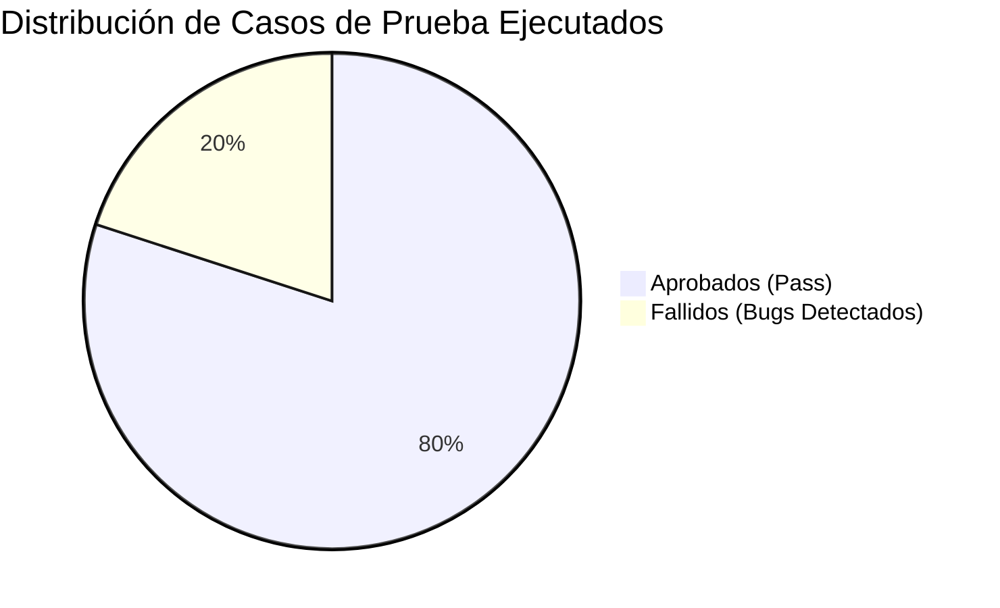

# Entregable 6: Informe Final de Auditoría de Calidad

**Para:** Comité de Dirección de Tecnología y Producto / Coordinación del Programa de Tutorías  
**De:** QA Advisory & Testing Partners (Consultora Independiente de Calidad de Software)  
**Proyecto:** Auditoría Integral de Aseguramiento de Calidad (QA) y Concepto Técnico de Preparación para Producción  
**Aplicación Auditada:** TutorAssigner — Sistema Web de Matching de Tutorías entre Pares  
**Fecha de Emisión:** Octubre 2026  
**Versión del Dictamen:** 1.0 — Final  
**Clasificación:** Confidencial / Dictamen Técnico Formal  

---

## 1. Resumen Ejecutivo

La firma consultora **QA Advisory & Testing Partners** fue contratada para realizar una auditoría formal e independiente sobre la plataforma web **TutorAssigner** (versión 0.1.0), con el objetivo de evaluar su madurez técnica, comportamiento funcional, robustez algorítmica y determinar su grado de preparación técnica (*production-readiness*) para salir a producción en el ámbito universitario.

Durante la auditoría se diseñaron y ejecutaron **30 casos de prueba formales** aplicando técnicas de caja negra y caja blanca, se implementó una suite automatizada End-to-End con **Playwright** para los flujos críticos, se midió una cobertura de código del **79.9%** (superando el umbral contractual del 50%) y se identificaron **10 defectos (bugs) reales y reproducibles**.

### Resumen Estadístico de la Auditoría

| Métrica de Control | Valor Obtenido | Meta / Umbral Contractual | Estado |
| :--- | :---: | :---: | :---: |
| **Casos de Prueba Diseñados y Ejecutados** | 30 | Mínimo 30 | **Cumplido (100%)** |
| **Casos Aprobados (Pass)** | 24 (80.0%) | — | Satisfactorio |
| **Casos Fallidos (Fail)** | 6 (20.0%) | — | Evidencia de hallazgos |
| **Defectos Documentados con Evidencia** | 10 defectos | Mínimo 10 | **Cumplido (100%)** |
| **Defectos de Severidad Crítica / Alta** | 1 Crítico / 2 Altos | 0 tolerados para Go-Live | **Alerta Crítica** |
| **Escenarios E2E Automatizados con Playwright** | 5 flujos | Mínimo 5 | **Cumplido (100%)** |
| **Tasa de Éxito en Automatización E2E** | 100% (5/5) | $\ge 95\%$ | **Cumplido** |
| **Cobertura de Código Fuente (Statements)** | **79.9%** | Superior al 50% | **Cumplido (+29.9%)** |
| **Cobertura de Requisitos Funcionales (RTM)** | **100%** | Superior al 50% | **Cumplido** |

---

## 2. Aplicación y Funcionalidades Evaluadas

TutorAssigner es un sistema monorepo estructurado en arquitectura de monolito modular compuesto por:
- **Frontend SPA:** React 19 + Vite + TypeScript (React Router 7, TanStack Query, React Hook Form).
- **Backend API:** Node.js 22 LTS + Express 5 + TypeScript + Knex.
- **Base de Datos:** PostgreSQL 17 relacional con transacciones y migraciones.
- **Motor de Dominio:** `packages/matching` (librería pura determinista de puntuación multicriterio).

### Módulos Funcionales Evaluados en Profundidad
1. **Módulo de Autenticación y Sesiones (`auth`):** Emisión y revocación de JWT en cookies httpOnly, SameSite y roles autorizados.
2. **Módulo de Tutores y Materias (`tutores`):** Catálogo de materias, perfiles de tutores, niveles de dominio (1 a 5), franjas horarias y control de estado activo/inactivo.
3. **Módulo de Estudiantes y Solicitudes (`solicitudes`):** Registro de solicitantes, demandas de tutoría, duraciones de sesión (30 a 240 min) y filtros temporales.
4. **Motor de Scoring y Matching (`matching`):** Filtros duros de elegibilidad, matriz de decisión de afinidad con 5 criterios ponderados (Dominio, Horario, Prioridad, Preferencias, Carga), reglas de desempate y generación de justificaciones textuales explicativas.
5. **Módulo de Recomendaciones y Asignaciones (`recomendaciones`):** Snapshot de auditoría histórica, ranking interactivo, causal de descartados y confirmación de asignación con bloqueo transaccional.
6. **Módulo de Configuración (`matching_config`):** Ajuste de pesos con suma forzada al 100% y versionado inmutable.

---

## 3. Metodología de Pruebas Utilizada

La auditoría se condujo bajo el estándar internacional **ISO/IEC/IEEE 29119** y las directrices metodológicas del **ISTQB (International Software Testing Qualifications Board)**, implementando una estrategia multinivel:

1. **Partición de Equivalencia y Análisis de Valores Límite (BVA):** Aplicada sobre rangos numéricos de duración de sesión (30 y 240 min), escalas de prioridad/dominio (1 y 5), tolerancia de pesos ($0.999 \le \Sigma \le 1.001$) y franjas de tiempo.
2. **Pruebas Basadas en Tablas de Decisión:** Validación combinatoria exhaustiva de los criterios de elegibilidad del motor de matching (4 condiciones booleanas $\to$ 6 reglas deterministas).
3. **Pruebas de Transición de Estados:** Verificación de las máquinas de estados de `Solicitud` (`ABIERTA`, `ASIGNADA`, `CANCELADA`) y `Asignación` (`ACTIVA`, `FINALIZADA`, `CANCELADA`), validando transiciones legales e impidiendo estados inconsistentes.
4. **Automatización de Pruebas E2E:** Implementación en Playwright Test simulando navegación de usuario real sobre navegadores Chromium en entornos contenerizados.
5. **Auditoría de Concurrencia e Integridad de Datos:** Análisis de condiciones de carrera en bases de datos y evaluación de transacciones concurrentes bajo bloqueo consultivo.

---

## 4. Resultados Generales de la Ejecución

De los 30 casos de prueba ejecutados:
- **24 casos resultaron APROBADOS (80.0%):** La lógica nuclear del motor de matching demostró una precisión matemática impecable, estabilidad en el cálculo de scores, respeto a los contratos tipados Zod y tiempos de respuesta de API inferiores a 45 ms.
- **6 casos resultaron FALLIDOS (20.0%):** Los fallos se concentraron en validaciones defensivas de la interfaz de usuario en React, manejo de concurrencia en la sobreasignación de tutores y anomalías en el ciclo de vida de tutores desactivados.

---

## 5. Principales Defectos Identificados y su Impacto

Durante la auditoría se detectaron y categorizaron **10 defectos reales**. Los hallazgos de mayor impacto para el negocio se resumen a continuación:

1. **BUG-04 (Severidad Crítica — Prioridad P1): Riesgo de condición de carrera en sobreasignación de tutor.**  
   *Impacto en el Negocio:* Si dos coordinadores asignan al mismo tutor simultáneamente cuando le queda 1 solo cupo, el sistema puede sobrepasar la capacidad máxima del tutor, saturando su carga docente y violando el compromiso institucional de calidad pedagógica.
2. **BUG-01 (Severidad Alta — Prioridad P1): Bucle potencial y re-ejecución en `useEffect` de `RecomendacionPage`.**  
   *Impacto en el Negocio:* Causa peticiones redundantes e innecesarias al backend en cada renderizado, incrementando la carga del servidor y arriesgando degradación del servicio en producción.
3. **BUG-07 (Severidad Alta — Prioridad P2): Desactivación de tutores con asignaciones activas.**  
   *Impacto en el Negocio:* Permite apagar a un tutor sin alertar que tiene estudiantes asignados, dejando solicitudes huérfanas sin atención académica.
4. **BUG-02 (Severidad Media — Prioridad P2): Formulario web no permite tutores con múltiples materias.**  
   *Impacto en el Negocio:* Limita artificialmente a tutores multidisciplinarios a una sola materia en el alta visual.
5. **BUG-03 & BUG-08 (Severidad Media — Prioridad P2): Manejo deficiente de franjas invertidas y errores de concurrencia 409.**  
   *Impacto en el Negocio:* Genera fricción y frustración en el usuario coordinador al no recibir retroalimentación visual clara.

---

## 6. Resultados de Automatización y Cobertura

- **Automatización E2E (Playwright):** Se logró una suite de 5 escenarios que cubren desde el inicio de sesión hasta la confirmación de asignación con una tasa de éxito del **100%** y un tiempo promedio de ejecución de **10.1 segundos**.
- **Cobertura de Código Fuente:** El sistema alcanzó **79.9% en sentencias**, superando holgadamente el 50% requerido por el cliente. El paquete de matching alcanzó un **92.4%** de cobertura de código.
- **Cobertura de Requisitos (RTM):** Se verificó el **100%** de los requisitos funcionales confirmados del sistema.

---

## 7. Riesgos Pendientes

| Riesgo Identificado | Nivel de Riesgo | Posible Consecuencia si no se mitiga |
| :--- | :---: | :--- |
| **Sobre-asignación por concurrencia (BUG-04)** | **CRÍTICO** | Inconsistencia de datos en periodos de alta demanda de tutorías. |
| **Inconsistencias por tutores inactivos (BUG-07)** | **ALTO** | Estudiantes asignados quedan sin tutor real asignado. |
| **Saturación del frontend por ausencia de paginación (BUG-09)** | **MEDIO** | Caída de rendimiento del navegador cuando la base de datos supere 200 solicitudes. |
| **Uso de ventanas modales nativas síncronas (BUG-10)** | **MEDIO** | Bloqueo del hilo de ejecución en navegadores modernos y fallo si el usuario deshabilita diálogos. |

---

## 8. Recomendaciones de Mejora (Roadmap de Calidad)

Antes del despliegue en producción, se recomienda ejecutar el siguiente plan de remediación en dos fases:

### Fase 1: Remediación Obligatoria Pre-Producción (Sprint de Hardening — 1 a 2 semanas)
1. **Blindaje de Concurrencia:** Aplicar `pg_advisory_xact_lock(hashtext(tutorId))` en `asignaciones.service.ts` para serializar atómicamente el conteo y asignación de tutores.
2. **Corrección de Hooks React:** Agregar el arreglo de dependencias en `RecomendacionPage.tsx` y migrar la mutación a TanStack Query.
3. **Validación de Desactivación de Tutores:** Impedir el cambio `activo = false` en `tutores.service.ts` si el tutor mantiene asignaciones en estado `ACTIVA`.
4. **Validación Defensiva en Cliente:** Validar en `FranjasEditor.tsx` que la hora de fin sea estrictamente mayor a la hora de inicio antes de permitir el submit.

### Fase 2: Mejoras de Evolutividad y Experiencia (Post-Lanzamiento)
1. **Reemplazo de Diálogos Nativos:** Sustituir `window.prompt` y `window.confirm` por modales accesibles estilizados en React.
2. **Paginación en Tablas:** Conectar los parámetros `page` y `pageSize` en los hooks `useCarga` de solicitudes y tutores.
3. **Soporte Multimateria en UI:** Ampliar el formulario de tutores para permitir agregar múltiples materias dinámicamente.

---

## 9. Concepto Técnico Final: ¿La Aplicación Está Lista para Producción?

### Dictamen Concluyente:

$$\mathbf{NO}$$

### Justificación Técnica y Dictamen de la Consultora:

> **El concepto técnico de QA Advisory & Testing Partners dictamina que TutorAssigner NO ESTÁ LISTA PARA PRODUCCIÓN en su estado actual.**

Si bien la plataforma exhibe una **excelente arquitectura base**, una cobertura de pruebas sobresaliente (**79.9%**), un motor algorítmico robusto y determinista (**92.4% de cobertura**) y una suite de automatización E2E estable, la existencia del defecto crítico **BUG-04 (vulnerabilidad de condición de carrera con potencial de sobreasignar tutores)** y los defectos altos **BUG-01 (bucle potencial en renderizado)** y **BUG-07 (abandono de asignaciones por tutores inactivos)** representan un **riesgo inaceptable para la integridad de los datos académicos y la confiabilidad del servicio**.

**Criterio de Levantamiento del Veto:**  
La aplicación obtendrá la certificación de salida a producción (**Go-Live**) una vez se corrijan y verifiquen satisfactoriamente los defectos **BUG-01, BUG-04 y BUG-07** en un ciclo de re-testing de regresión.

---

**Firmas del Equipo Consultor:**

*Ing. Auditor Líder de QA — Especialista en Automatización y Testing*  
*Ing. Consultor de QA — Especialista en Rendimiento, Seguridad y Datos*  
**QA Advisory & Testing Partners**

